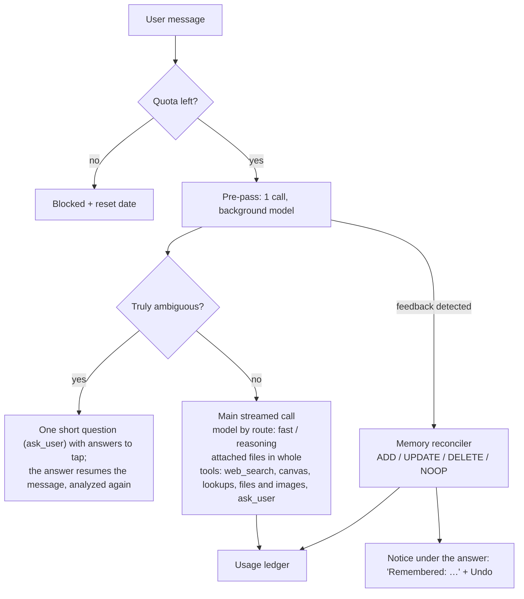

# Open Agent — Specification

A private AI chat app for friends and family (fewer than 50 people), as simple as DeepSeek's chat but with a memory
that learns how each person likes to work. Served at `open-agent.jonas.bzh`.

## Why

People in the circle use ChatGPT free and get poor results: a small model after a few messages, no lasting context,
short vague prompts. Open Agent fixes what a harness can fix:

- it learns each user's corrections and never makes the same mistake twice;
- it picks the right model for the task, without asking;
- it improves vague requests, or asks one short question when the request is truly ambiguous;
- it searches the web and reads documents and photos.

## Users and access

- Invitation only. The admin invites an email address; the invitation email holds a sign-in link valid 7 days.
- Sign-in: the person types their address and receives a **magic link and a 6-digit code**, both valid 15 minutes,
  once. The code exists for the installed app on iOS, which cannot receive the link (iOS opens it in Safari).
- The sign-in form answers the same for invited and unknown addresses, and sends nothing to the latter.
- Limits: 5 emails per address and 10 wrong codes per address every 15 minutes.
- Sessions last 180 days. Revoking a user ends all their sessions at once; inviting them again restores the access.
- Roles: `user`, `admin`. The `ADMIN_EMAIL` user is made admin at every boot. An admin cannot revoke themselves.
- Admin data access: conversations are stored in clear in the database. The admin commits not to read them; the admin
  panel shows costs and memory rules, never conversations.

## Cost model

- **Hybrid keys.** The app's OpenRouter key by default. Anyone may add their own OpenRouter key (BYOK, OpenRouter
  only, in the user menu): OpenRouter checks it (`GET /api/v1/key`) before it is kept, encrypted with AES-256-GCM
  (`ENCRYPTION_KEY`); the person sees only its last 4 characters. Every call of theirs (answer, pre-pass, memory,
  title) then uses it; the ledger keeps them with `paid_by_user`, outside the quota and the admin's monthly cost, and
  their limit does not apply while the key is there (the admin's setting is kept for the day they remove it). A key
  OpenRouter refuses during an answer (401, 402, 403) shows "OpenRouter refused your key" instead of a plain failure.
- **Quota per user, per calendar month, in real cost.** Every paid call (answers, pre-pass, memory, titles) records the
  cost returned by OpenRouter; searches count at 0 $. The month starts at midnight on the 1st in Paris. Default quota
  5 $ (`DEFAULT_MONTHLY_QUOTA_USD`; the user expects 3 to 5 regular users), changed per person by the admin
  (0 to 100 $). Admins have no limit.
- **What users see:** a gauge in percent in the user menu ("This month: 65% used"), never dollars. From 80% a line
  above the composer says how much is used.
- **Over quota: blocked.** The check runs before each message (the message that crosses the limit is still answered).
  The server refuses with `quota_exceeded` (429), and the composer is replaced by "You have used all of your quota this
  month. It comes back on December 1." No silent downgrade.
- Total budget target: under 20 €/month. Background calls always use the cheapest configured model. Set a credit limit
  on the OpenRouter key itself as the global safety net.

## Per-message pipeline

### Pre-pass

One structured-output call on the background model (thinking off, about 0.6 s and 0.00006 $) returns:

- `route`: `fast` (thinking off) | `reasoning` (same model, thinking `medium`). No `vision` route: the same DeepSeek
  model reads pictures (measured on a screenshot: 1.1 s, 0.0002 $);
- `clarifyingQuestion`: one short question instead of an answer, or null, with `clarifyingOptions`, up to 4 likely
  answers to tap (none when they cannot be guessed). It is sent as an `ask_user` call, the same as the model's own
  questions. Never twice in a row: after a question, answered or not, the next analysis cannot ask;
- `rewrittenRequest`: the same request, clear and in the first person, when it was written in a hurry, or null. Only
  the model sees it; the conversation keeps the user's words, and the answer's metadata keeps the rewrite;
- `feedback`: a lasting preference about how the assistant works ("your answers are always too long"), or null for a
  remark about the current task only ("shorter", about the letter being written);
- `webSearch`: whether the answer needs facts from the web; when true, the first step must search.

The rules and examples sit in the instructions: OpenRouter does not show the schema's field descriptions to the model.
When the pre-pass fails, the user gets the `fast` answer to their own words. The user never picks a model; the answer
shows a "Deep thinking" line, pulsing while the model thinks, with its reasoning folded underneath.

### Memory: "never the same mistake twice"

- **Scope:** one global list of rules per user: how they like the assistant to work, and lasting facts about them that
  answers depend on (where they live, household, job, diet, equipment). Facts about the current task only (a date, a
  budget for this trip) are not kept. Every answer gets them at the end of the system prompt: preferences to follow,
  facts to use when they matter.
- **Capture:** automatic. When the pre-pass returns `feedback` (a preference, a lasting fact, or anything the user asks
  to remember), the reconciler (background model) receives it with the current rules and returns one operation:
  `add`, `update` (replace or invert a rule), `delete`, or `none`. An edit naming a rule that is not the user's, or
  adding to a full memory, is dropped.
- **"Remember" button** on the user's own messages (next to Copy and Edit, once the answer is done): the reconciler
  gets the whole message (2,000 characters at most) as an explicit request, keeps what lasts in it as one rule, and
  answers `none` only when a rule already says it. The notice, with Undo, shows under the message for this visit (or
  "Already in your memory"); the rule itself is on the memory page. Counted in the quota like any memory call.
- **Contradiction:** a remark opposite to a stored rule updates that rule; it never adds a second, conflicting one.
- **Visible:** the change shows under the answer to the remark ("Updated: “Short answers.” → “Detailed answers.”"),
  with Undo and a link to the memory page. The notice is a `data-memory` part of the answer, so it stays in the
  conversation; after Undo it reads "Undone".
- **Undo:** puts the rule back as it was, once, and only while the rule is still as the change left it; otherwise
  "this preference changed since".
- **Control:** a "My memories" page (sidebar, for everyone) lists, adds, edits and forgets rules.
- **Limits:** 50 rules of 300 characters per user. Every change is kept in `memory_rule_changes`, which powers Undo.
- **The admin** reads a person's rules on the people page and forgets one the assistant misunderstood (recorded with
  the source `admin`).
- **Tu or vous:** French answers and clarifying questions say « vous » by default; « tu peux me tutoyer » becomes a
  rule, and rules win over the default. The interface always says « vous ».

## Features (all in V1)

### Chat

- Streaming answers (Vercel AI SDK UI message stream).
- Regenerate an answer; edit a sent message and resend (the later messages are replaced, no branches).
- Automatic conversation titles (background model); pin conversations.
- **Search in the history** ("Search" in the sidebar, ⌘K / Ctrl+K): SQLite FTS5 on the text of every message,
  accents aside (`remove_diacritics`), every word required and open-ended (« resil » finds « résiliation »). One row
  per conversation, last updated first, with the passage of its best message and the words found highlighted;
  Markdown marks are removed from the passage. Enter opens the first one. Triggers keep the index in step with every
  write, edits and deletions included. Titles are not searched: they repeat the first message.
- **Questions to the user** (`ask_user`, like in Claude Code): the pre-pass or the model asks one question, with up to
  4 answers to tap; the user may also type their own in the composer, which then says "Your answer…". The model's
  tool has no `execute`: its call ends the stream, and the question waits, saved, even across a reload. The answer is
  the tool's output; once every question of the message has one, the client sends the history again
  (`sendAutomaticallyWhen`) and the same message goes on: after the pre-pass's question, the pre-pass runs again with
  the answer (and may not ask again); after the model's, its answer goes on with the same route. One round of
  questions per answer: asked again in the same message, the tool answers `null` itself, and the model decides alone
  and says what it assumed. A question left unanswered (the user wrote something else) reaches the model as `null`.
  The question and its answer show first in the bubble.

### Web search

- **Services:** Tavily first (free plan: 1,000 searches a month, no card, refuses with `432` once used up), then our
  own SearXNG (free, titles and short extracts only). A used-up service is skipped until the 1st of next month; a
  service that fails for another reason is tried again at the next search. Both sit behind the `WebSearch` port.
  Compared on 2026-11-01: Parallel and Brave need a card, Exa's and Linkup's terms do not fit, Google and Bing closed.
- **When:** the main model has a `web_search` tool (query, `recent`) and uses it for facts that change or that it may
  not know. When the pre-pass sets `webSearch`, the first step must search. At most two searches per answer: then the
  search tool is withheld.
- **What the user sees:** a line "Searching the web: “…”" pulsing in the answer, then one link per site read; the
  answer links its sources inline. A failed search says so and the model answers without it.
- **Language:** French users get French results (Tavily `language`, `country: france`; SearXNG `fr-FR`). Safe search on.
- **Cost:** each search is a `web_search` usage event at 0 $; each model step is its own `answer` event. Measured: a
  turn with two searches ≈ 0.0003 $.

### Lookups

The main model looks things up rather than guess (`ContextTools`, `application/context-tools.ts`); everything is the
user's own or public, and nothing writes.

- **Date and time:** not a tool. "[Now: Tuesday, 3 November 2026 at 22:42, Paris time.]" opens the user's latest
  message, for the model only: there it changes nothing before it, so the provider's prompt cache stays valid.
- **The user's other conversations:** `search_conversations` (the history's full-text search, the current one left
  out) then `read_conversation` (its messages as "User:" / "Assistant:" text, the latest 30,000 characters).
- **The user's library:** `list_files` (30 newest) then `read_file`: its text, without its pictures (the model is told
  there are some, and asks the user to attach the file to see them). A file over 50,000 tokens is refused rather than
  read in part: attached, the model reads all of it.
- **A web page:** `read_web_page` for a link the user gives, or a search result whose extract is not enough. Fetched by
  the server, every address and redirect checked public (private, loopback, link-local and Docker addresses refused:
  no SSRF), http(s) on ports 80/443 only, 3 MB at most, then read like Firefox's reader view (Readability on
  linkedom; the whole text without scripts and menus when the reader view finds under 1,000 characters). The model
  reads 30,000 characters. Sites that refuse robots (403) say so.
- **Weather:** `weather` (place, 1 to 7 days) from Open-Meteo (free, no key, Météo-France for France): now, then each
  day's sky, min/max, rain chance and amount. Where the user lives comes from the memory. The pre-pass never forces a
  web search for the weather.
- **Exact calculations:** `calculate` with mathjs (sums, percentages, conversions such as "5 km to mile"; the functions
  that change mathjs or parse further are switched off); `days_between` and `date_plus_days` count calendar days in
  UTC (no clock-change surprises).
- **Limits:** each call sends the whole conversation to the model again, so each tool has a cap per answer (2
  conversation searches and reads, 1 file list, 2 file reads, 3 pages, 2 forecasts, 5 calculations, 3 date counts),
  and an answer has 6 steps, the last one without tools. A refusal (`ToolRefusal`: not found, someone else's, too
  long, unknown place) reaches the model and stays with the call, so it reads it again later, as do the fields a call
  missed (DeepSeek once called a tool with `{}`); any other failure is hidden as "The answer failed.".
- **What the user sees:** one line per lookup in the answer ("A relu « Prénoms pour chat roux »", "Météo : Nantes…",
  "(3*19.99 + 2*7.45) * 0.85 = 63.6395"), pulsing while it runs; a conversation, file or page links to it.
- **The pre-pass knows:** it never asks the user for a file, an earlier conversation, a page, the weather or the time.

### Files and images the model makes

Dedicated tools, not code the model writes and runs (`MakingTools`, `application/making-tools.ts`; the files behind
the `FileMaker` port, `infrastructure/files/office-file-maker.ts`). Each file is saved into the user's library like an
upload (so `read_file` reads it later, and it shows in "My files" on every device), and shows in the answer: an image
centered, with "Download", opening over the app when tapped (`ImagePreview`), another file as a card that downloads it
(a PDF opens in the browser's viewer). A failed
try the model then made right is not shown.

- **Images:** `generate_image` (an English prompt, `16:9` or `9:16`, up to 3 `sourceImageIds`) on the `image` role's
  model, default `google/gemini-3.1-flash-lite-image`, through OpenRouter's chat API with `modalities: ["image",
  "text"]` and `image_config.aspect_ratio`: its cost then comes like any answer's, as a usage event `image`, paid by
  the user's own key when they gave one. To change an image, the model passes the ids of the user's pictures (attached
  ones show theirs in `<file id="…">`) or of one drawn before. Measured: 4 to 6 s and 0.0336 $ an image (1,120 image
  tokens); 768 × 1376 in portrait. A picture the model refuses to draw (safety) comes back as its words, told to the
  model.
- **Excel:** `create_spreadsheet` (sheets of columns with a format: text, number, integer, euro, percent, date; rows;
  a text starting with "=" is a formula) with exceljs: a bold indigo header row, frozen, with filters. Excel computes
  the formulas when it opens the file.
- **PDF:** `create_pdf` from Markdown (titles, bold, lists, task boxes, tables, quotes, links) with pdfmake and its
  Roboto, A4, page numbers past one page; `` shows a JPEG or PNG of the user's library. pdfmake reads no
  URL and no file but its fonts. For a text to edit, the model still uses the canvas.
- **Charts:** `create_chart` from a Vega-Lite spec with its data inline, drawn as a PNG (resvg, twice the size, Roboto,
  indigo first). Safe to run on the server: a spec naming a `url` anywhere is refused (Vega would load it), the
  expressions are evaluated by `vega-interpreter` (no generated code), pictures are stripped from the SVG before resvg
  (which reads paths from the disk), and a chart over 2,000 pixels is refused.
- **QR codes:** `create_qr_code` (a link, a text, a Wi-Fi network as `WIFI:T:WPA;S:…;P:…;;`, a vCard), 800 px PNG.
- **Limits per answer:** 2 images, 2 workbooks, 2 PDFs, 3 charts, 2 QR codes.
- **The pre-pass knows:** a drawing or a file is never unclear for want of a style, colors or a format; making one
  never needs the web.

### Files and photos

- **Rule: everything in a file reaches the model, at every answer.** A user who asks « vous avez vu … dans le
  fichier ? » must get a real answer, even ten messages later. Nothing is cut: a file the model cannot read whole
  (more than about 600,000 tokens) is refused at upload with a clear message, never read in part.
- **Adding:** the paperclip of the composer (from this device, take a photo on mobile, from my files), drag and drop,
  or paste a screenshot. At most 5 files per message, 20 MB each. Chips show them while they upload.
- **Photos:** made at most 2,048 px wide or tall in the browser (JPEG) before upload: fast on a phone, small print
  stays readable. The model sees them.
- **PDFs:** every page goes twice: its text (`pdftotext -layout`, keeps tables) and its picture (`pdftoppm`, 110 dpi).
  So charts, stamps, handwriting, pictures and scanned pages are read too. Measured: a page picture costs a few
  hundred tokens on DeepSeek.
- **Word (.docx):** mammoth's HTML (keeps tables), the pictures it contains, and the headers and footers mammoth
  skips, read from the zip with `unzip`. EMF/WMF drawings cannot be shown; the model is told one is there.
- **Text (.txt, .md, .csv):** as is. **Excel (.xlsx):** each sheet as numbered rows, with formulas (and their result
  when Excel saved one) and dates; a zip expanding past 100 MB is refused before exceljs reads it. Not accepted: HEIC
  from browsers that cannot open it, .doc, .xls, PowerPoint, HTML, SVG.
- **Reading happens once, at upload**, into the file's `content`; the pictures are stored next to the original. Each
  answer turns the message's `file` parts into `<file id="…" name="…">` + text and pictures; the pre-analysis and the
  title only see the names (`[Attached: …]`), so the pre-analysis never asks what a file contains.
- **Personal library ("My files"):** every uploaded file stays, reusable in any conversation from the paperclip
  ("From my files", with a search), with the files and images the model made. The page is a grid of tiles, not a
  list: an image fills its tile, a PDF shows its first page (`/api/files/:id/preview`), Word, Excel and text files
  show their icon and type. An image tile opens the image over the page (`ImagePreview`), any other tile the file;
  files are added with a button or dropped on the page, and deleted from the tile. A deleted file stays named in
  its conversations, and the model is told it is gone. No `@` mention, no RAG, no embeddings.
- **Privacy:** a file opens only for its owner (`/api/files/:id`, `nosniff`); a message may only point to the
  user's own library files, never to a link or inline data, so nothing skips the reading at upload.
- **Cost:** in the quota like the rest. Measured: 0.0001 to 0.0007 $ per answer with a 2-page PDF and a photo
  (about 3,200 tokens). A big file costs at every answer of its conversation.

### Commands

A user's usual requests, run again without retyping them (`Commands`, `application/commands.ts`).

- **Making one:** asked in a conversation ("Fais-moi une commande qui corrige les fautes de mes textes"): the model
  writes the prompt as standing instructions for any text and picks a short name, with `save_command`; the answer
  shows "Commande /corriger créée", linked to the page. Asked again with the same name, it rewrites it. The model knows
  the user's command names. Or by hand in "My commands" (`/commands`): name, prompt, how often it ran; edit, delete.
- **Names:** what is typed after `/`: lowercase letters (accents too), digits and dashes, from a letter, 24 at most,
  unique per user (`commandNameOf`, shared by the client and the server). 50 commands at most, 4,000 characters of
  prompt.
- **Running one:** `/cor` at the start of the field lists the commands it may start (arrows, Enter or Tab, or a tap),
  `/corriger ` typed in full picks it too, or a tap on its button in the field, between the paperclip and the send
  button (in the user's order, scrolled sideways when they do not fit). The field then shows a badge; Backspace in an
  empty field or its cross removes it. A command alone, without text, applies to the conversation so far.
- **Order:** the user's own, dragged by a handle in "My commands" (mouse, finger or keyboard), shown at once and saved
  whole (`PUT /api/commands/order`: every command once, or refused). A new command comes first, made by hand or by the
  model. Commands made before the order existed kept the one they showed in (most used first).
- **What is sent:** the message keeps the user's words and `metadata.command` (`id`, `name`), shown as a badge in
  their bubble. At each answer the server puts the command's current prompt before those words, for the model, the
  pre-analysis and the title; never in the saved conversation. A command deleted since is said so. Each message
  counts one use. An edited message keeps its command.
- **Sync:** a change publishes `commands`: the other devices reload the list.

### Canvas

A panel beside the conversation (full screen on a phone, `?doc=` in the address, back closes it) holding documents
written by the model and edited by the user, with versions. The document open in each conversation is remembered on
the device (`localStorage`, 100 conversations at most): coming back to the conversation from elsewhere opens it again;
closing the panel forgets it.

- **The model's tools:** `create_document` (kind `document` or `html`, title, whole content) and `update_document`
  (id, whole new content). It writes any text to keep, send or print there, never in the chat, then answers in one
  or two sentences. A card in the answer ("Lettre de résiliation · Version 3") opens the document.
- **Live:** the panel opens as soon as the model starts writing and shows the text as it comes, read-only in the same
  editor as the saved document (whose code loads meanwhile). Once written, that text stays on screen until its saved
  version is loaded, then the saved document takes its place: no closed frame, no "Loading…", never the old version.
- **The model always works on the latest version:** the instructions hold the latest content of every document of
  the conversation, the user's own edits included; past versions in tool calls are left out of the history so a long
  document is not paid for again at every version.
- **Documents (Markdown):** edited like in Word with Tiptap (`@tiptap/markdown` reads and writes the Markdown the
  model uses), loaded only with the panel. Saved 1.2 s after typing stops. Saves within 10 minutes of the user's own
  last version change that version: one version per sitting. A save based on an older version is refused
  (`artifact_changed`): the panel then shows the model's newer version.
- **Versions:** a menu lists them (who, when); an old one shows read-only and can be brought back, as a new version
  marked `restored_from` ("v4 · v1 brought back by you"), never merged into the user's last one. A newer version,
  written by the model meanwhile, replaces the old one being looked at.
- **The model knows of a restore:** while the latest version of a document is a restore, the document carries
  `restored-from` in the instructions, and a note opens the user's latest message (for the model only) saying the later
  changes were undone on purpose. In the instructions alone the model redid them: it saw them asked and confirmed
  earlier in the history (2026-11-03).
- **Exports:** Word (`docx` in the browser, loaded on first use: headings, bold, italics, lists, links, tables, line
  breaks) and PDF through the browser's print dialog, from the page itself with a print stylesheet (printing an
  iframe fails in Safari on iPhone), always in light colors, with the title as the file name.
- **HTML pages:** a complete page with inline CSS and JavaScript (no React), shown in an `iframe` with `srcdoc` and
  `sandbox="allow-scripts allow-modals allow-forms"`, without `allow-same-origin`: the page can never reach the app,
  its API or its cookies (checked: reading `document.cookie` throws). Preview and Code tabs; downloadable `.html`.
- Other code (Python, etc.) stays in chat code blocks with highlighting and a copy button.

### Admin panel

- Invitations: create and revoke access by email. Cost per person for the month and their quota.
- **Models (Settings page):** the OpenRouter model of each role, changed at runtime, for the next message. The
  picker lists OpenRouter's models (kept an hour by the server, `:batch` variants left out), cheapest first, with
  their prices, and only those that can take the role: text and pictures in, tools, and thinking that can be turned
  off (OpenRouter's `reasoning.mandatory` unset) for `fast`; text and pictures in, tools and reasoning for
  `reasoning`; text in, structured JSON and thinking that can be turned off for `background`; text and pictures in and
  images out for `image` (`missingCapabilities`). The server checks it again on save. Thinking per role stays in the
  code (off, `medium`, off). The price shown is the text's: an image costs about 0.03 $ more.
- **Prompts (Settings page):** the assistant, the analysis of each message and the memory prompts, edited whole, used
  from the next message, with "Bring back the original" (the text in `default-prompts.ts`). What depends on the
  conversation is always added by the code after the text: the date and the app's language, a missing web search,
  the canvas documents and the person's rules for the assistant; a question just asked for the analysis; a full
  memory for the memory. Structured outputs keep the JSON fields even if a prompt forgets them.
- **Memory:** a person's rules ("See their memory"), each one can be forgotten.

### Other

- UI in French and English (i18next) from the start; the model answers in the user's language.
- Responsive PWA, installable on the home screen.
- **Every device of a user stays in step** (server-sent events, `GET /api/events`): after each change the server
  sends a small `ChangeEvent` (`conversation` with its id, `conversations`, `memory`, `files`, `artifact` with its id),
  never the data; each open device reloads what it shows. An answer appears whole on the other device once finished,
  not word by word. A conversation open there is replaced by the saved copy, unless an answer is on its way on that
  device; one deleted elsewhere sends its page back to the start. The browser reconnects by itself (a phone waking up),
  and everything is reloaded once then, for the changes missed. One server process: the feed lives in its memory; a
  `: ping` comment every 25 s keeps proxies from closing a quiet stream.

## Out of V1

Voice, code execution, conversation branches, public share links, BYOK for providers other than OpenRouter, global
spending kill switch in the app.

## Stack

Same layout and tooling as `inscript-carte`.

| Layer | Choice |
| --- | --- |
| Monorepo | Turborepo, Bun workspaces (`apps/*`, `packages/*`) |
| Runtime | Bun |
| Server | `Bun.serve({ routes })`, hexagonal: `domain/`, `application/` (+ `ports/`), `infrastructure/`, `presentation/http/`, composition root in `app.ts` |
| Database | SQLite (`better-sqlite3`) + knex, migrations applied at boot, FTS5 for search |
| LLM | Vercel AI SDK with the OpenRouter provider |
| Client | Vite, React 19, TanStack Router, TanStack Query, i18next, Tailwind v4, shadcn (`radix-vega` style) |
| Shared | `packages/shared`: `API_ROUTES`, request and response types, `ApiError` codes |
| Email | Plunk API |
| Web search | Tavily, then self-hosted SearXNG |
| Lint, format | oxlint, oxfmt |
| Tests | `bun test`, co-located `*.test.ts` |
| Deploy | `deploy/compose.yaml` creates the stack once (e.g. as a Portainer stack): the app (API + built client on one port, `/data` in a volume) and `open-agent-searxng` (SearXNG with `searxng/settings.yml` inside, reached only by the app). Then `bun run deploy` pushes both images to `registry.jonas.bzh` and recreates the two containers, by name, through the Portainer API |
| Development | `bun run dev` starts `compose.yaml` (SearXNG on `localhost:8888`), then the server and Vite |

## Look and feel

- Modeled on Chatbox AI: the sidebar and the top bar (page title) share one grey frame; the page is a white panel
  below the top bar, with a rounded top-left corner. A tinted "New conversation" button tops the sidebar, the user
  menu ends it. In dark mode the frame is darker than the panel. A conversation's title in the top bar is edited in
  place: a tap makes it a field, Enter or leaving it saves, Escape gives up.
- One brand color: indigo night `#2a2c6e` (`oklch(0.333 0.112 277)`), no gradients: actions, the icon, and the user's
  bubbles. Neutral greys elsewhere; the assistant's bubbles are grey.
- Dark mode: charcoal surfaces and a lighter indigo (`oklch(0.52 0.15 277)`), since `#2a2c6e` disappears on them.
  The user picks "Like the device", "Light" or "Dark" in the user menu; the choice is applied before the first paint.
- Rounded like Chatbox (`--radius: 0.625rem`): 8px on buttons, fields and menu items, 10px on lists, 14px on cards;
  round avatars and badges.
- Font: Figtree. Controls at least 40px high on sign-in and admin forms, for older users.
- Phones: the sidebar becomes a drawer. Chat: the user's messages in a bubble on the right, answers in a grey
  bubble with action badges ("Read contrat.pdf", "Web search"), documents as cards, memory changes as an inline
  notice with Undo, a bordered composer with attach and send buttons.

## Data model (first draft)

| Table | Holds |
| --- | --- |
| `users` | email, role, locale, invited at/by, last sign-in, revoked at, monthly quota in USD (`null`: the default), own OpenRouter key (sealed) and when it was added |
| `sign_in_requests` | user, token hash, code hash (none for invitations), expiry, used at |
| `sessions` | token hash, user, expiry |
| `conversations` | id chosen by the client (UUID), user, title, pinned, created/updated at |
| `messages` | conversation, id (unique per conversation: the client chooses it), position, role, the whole AI SDK UI message as JSON |
| `message_search` | FTS5 over the text parts of each message, sharing its `rowid`; filled by triggers on `messages` |
| `memory_rules` | user, rule text, created/updated at, deleted at (kept so an Undo restores the same rule) |
| `memory_rule_changes` | user, rule, operation, before, after, source (`remark` / `user` / `admin`), conversation and message of the notice, undone at |
| `library_files` | id (UUID, in its address), user, name, kind (`image` / `pdf` / `word` / `text`), media type, size, content (JSON: whole text and names of the pictures on disk), created at |
| `artifacts` | id (UUID, named by the model in `update_document`), conversation, user, kind (`document` / `html`), title, created/updated at |
| `artifact_versions` | artifact, number (from 1), content, author (`model` / `user`), created at, the version it brought back (`restored_from`) |
| `usage_events` | user, conversation, purpose (`answer`, `pre_pass`, `memory`, `title`, `web_search`), model or search service, input/output/reasoning tokens, cost in USD from OpenRouter, paid by the user's own key |
| `settings` | key (`model.fast`, `prompt.assistant`…), value, updated at; a missing key means the default |
| `commands` | id (UUID), user, name (unique per user), prompt, uses, position (the user's order), created/updated at |

## Configuration

| Env var | Purpose |
| --- | --- |
| `PORT` | HTTP port (default 3427) |
| `TRUST_PROXY` | Behind the reverse proxy: the sign-in limits read the client's address in `x-forwarded-for` (`1` in the image) |
| `DATABASE_PATH` | SQLite file |
| `FILES_PATH` | Uploaded files and the pictures read out of them (default `data/files`; `/data/files` in the image) |
| `CLIENT_DIST_PATH` | Built client, served next to the API |
| `PUBLIC_URL` | Base URL in magic links |
| `ADMIN_EMAIL` | First admin |
| `DEFAULT_MONTHLY_QUOTA_USD` | Quota of users the admin did not set (default 5) |
| `OPENROUTER_API_KEY` | App key (required in production) |
| `FAST_MODEL` | Everyday answers until the admin page changes it; default `deepseek/deepseek-v4.1-flash-1017`, thinking off |
| `REASONING_MODEL` | Answers that need thinking, same; thinking `medium` |
| `BACKGROUND_MODEL` | Pre-pass, memory and titles, same; thinking off |
| `IMAGE_MODEL` | Images the user asks for; default `google/gemini-3.1-flash-lite-image` |
| `TAVILY_API_KEY` | First web search service (optional) |
| `SEARXNG_URL` | Our SearXNG, e.g. `http://open-agent-searxng:8080` (default `http://localhost:8888` in development) |
| `PLUNK_API_KEY` | Sign-in emails (unset in development: links and codes go to the server log) |
| `MAIL_FROM` | Sender address; its domain must be verified in Plunk |
| `ENCRYPTION_KEY` | Encrypts the users' own OpenRouter keys at rest (required in production; changing it means they enter their keys again) |
| `SEARXNG_SECRET` | Secret of the SearXNG container (required: it refuses to start with its default one) |
