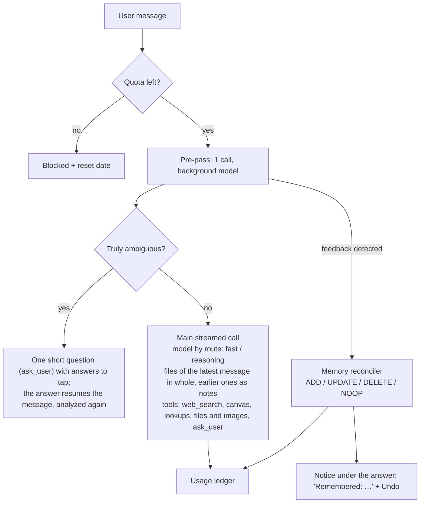

# Open Agent — Specification

A private AI chat app for friends and family (fewer than 50 people), as simple as DeepSeek's chat but with a memory
that learns how each person likes to work. Served at `open-agent.jonas.bzh`.

## Why

People in the circle use ChatGPT free and get poor results: a small model after a few messages, no lasting context,
short vague prompts. Open Agent fixes what a harness can fix:

- it learns each user's corrections and never makes the same mistake twice;
- it picks the right model for the task, without asking;
- it improves vague requests, or asks one short question when the request is truly ambiguous;
- it searches the web and reads documents and photos.

## Users and access

- Invitation only. The admin invites an email address; the invitation email holds a sign-in link valid 7 days.
- Sign-in: the person types their address and receives a **magic link and a 6-digit code**, both valid 15 minutes,
  once. The code exists for the installed app on iOS, which cannot receive the link (iOS opens it in Safari).
- One live code per user: a new sign-in email retires the earlier code (a pending invitation link stays valid).
- The sign-in form answers the same (204), and as fast, for invited and unknown addresses, and sends nothing to the
  latter: the email is sent in the background and a failure is only logged, since waiting for the SMTP server, or
  reporting its failure, would tell an invited address apart.
- The language chosen on the form becomes the user's only once the link or the code is used
  (`sign_in_requests.locale`): anyone may type an address.
- Limits: 5 emails per address and 10 wrong codes per address every 15 minutes, in memory; on top of them, a code
  allows 5 tries, counted in the database (`sign_in_requests.code_tries`), so a restart does not reset them.
- Sessions last 180 days. Revoking a user ends all their sessions at once; inviting them again restores the access.
  An open app whose session ended (signed out elsewhere, revoked, expired) goes to the sign-in page at its next
  request.
- A change (any method but GET, HEAD and OPTIONS) whose `Origin` is not the origin of `PUBLIC_URL` is refused (403):
  `SameSite=Lax` alone lets a page of a sibling subdomain post with the session cookie. A request without `Origin`
  passes: browsers name the origin of a change sent from another page, and a script outside the browser does not
  hold the cookie.
- Roles: `user`, `admin`. The `ADMIN_EMAIL` user is made admin at every boot. An admin cannot revoke themselves.
- Admin data access: conversations are stored in clear in the database. The admin commits not to read them; the admin
  panel shows costs and memory rules, never conversations.

## Cost model

- **Hybrid keys.** The app's OpenRouter key by default. Anyone may add their own OpenRouter key (BYOK, OpenRouter
  only, in the user menu): OpenRouter checks it (`GET /api/v1/key`) before it is kept, encrypted with AES-256-GCM
  (`ENCRYPTION_KEY`); the person sees only its last 4 characters. Every call of theirs (answer, pre-pass, memory,
  title) then uses it; the ledger keeps them with `paid_by_user`, outside the quota and the admin's monthly cost, and
  their limit does not apply while the key is there (the admin's setting is kept for the day they remove it). A key
  OpenRouter refuses during an answer (401, 402, 403) shows "OpenRouter refused your key" instead of a plain failure.
- **Quota per user, per calendar month, in real cost.** Every paid call (answers, pre-pass, memory, titles) records the
  cost returned by OpenRouter; searches count at 0 $. Known limit: a step stopped mid-way (Stop, deleting the
  conversation) is not recorded, as the AI SDK gives no usage for it. The month starts at midnight on the 1st in
  Paris. Default quota 5 $ (`DEFAULT_MONTHLY_QUOTA_USD`; the user expects 3 to 5 regular users), changed per person by
  the admin (0 to 100 $). Admins have no limit.
- **What users see:** a gauge in percent in the user menu ("This month: 65% used"), never dollars. From 80% a line
  above the composer says how much is used.
- **Over quota: blocked.** The check runs before each message (the message that crosses the limit is still answered).
  The server refuses with `quota_exceeded` (429), and the composer is replaced by "You have used all of your quota this
  month. It comes back on December 1." No silent downgrade. Since the check comes before the answer, one person has at
  most 3 answers being written at once (the fourth gets `conversation_busy`): together they could spend far more than
  what was left.
- Total budget target: under 20 €/month. Background calls always use the cheapest configured model. Set a credit limit
  on the OpenRouter key itself as the global safety net.

## Per-message pipeline

### Pre-pass

One structured-output call on the background model (DeepSeek V4.1 Flash, thinking off, about 0.6 s and 0.00006 $; it
runs before every answer, so it must stay fast) returns:

- `route`: `fast` (Gemini 4 Hydrogen) | `reasoning` (Gemini 4 Neon, thinking `medium`). No `vision` route: both read
  pictures, recordings, videos and PDFs. The pre-pass only reads text: the files' names, never their content;
- `clarifyingQuestion`: one short question instead of an answer, or null, with `clarifyingOptions`, up to 4 likely
  answers to tap (none when they cannot be guessed). It is sent as an `ask_user` call, the same as the model's own
  questions. Never twice in a row: after a question, answered or not, the next analysis cannot ask;
- `rewrittenRequest`: the same request, clear and in the first person, when it was written in a hurry, or null. Only
  the model sees it; the conversation keeps the user's words, and the answer's metadata keeps the rewrite;
- `feedback`: a lasting preference about how the assistant works ("your answers are always too long"), or null for a
  remark about the current task only ("shorter", about the letter being written);
- `webSearch`: whether the answer needs facts from the web; when true, the first step must search.

The rules and examples sit in the instructions: OpenRouter does not show the schema's field descriptions to the model.
When the pre-pass fails, the user gets the `fast` answer to their own words. The user never picks a model; the answer
shows a "Deep thinking" line, pulsing while the model thinks, with its reasoning folded underneath.

### Memory: "never the same mistake twice"

- **Scope:** one global list of rules per user: how they like the assistant to work, and lasting facts about them that
  answers depend on (where they live, household, job, diet, equipment). Facts about the current task only (a date, a
  budget for this trip) are not kept. Every answer gets them at the end of the system prompt: preferences to follow,
  facts to use when they matter.
- **Capture:** automatic. When the pre-pass returns `feedback` (a preference, a lasting fact, or anything the user asks
  to remember), the reconciler (background model) receives it with the current rules and returns one operation:
  `add`, `update` (replace or invert a rule), `delete`, or `none`. An edit naming a rule that is not the user's, or
  adding to a full memory, is dropped.
- **"Remember" button** on the user's own messages (next to Copy and Edit, once the answer is done): the reconciler
  gets the whole message (2,000 characters at most) as an explicit request, keeps what lasts in it as one rule, and
  answers `none` only when a rule already says it. The notice, with Undo, shows under the message for this visit (or
  "Already in your memory"); the rule itself is on the memory page. Counted in the quota like any memory call.
- **Contradiction:** a remark opposite to a stored rule updates that rule; it never adds a second, conflicting one.
- **Visible:** the change shows under the answer to the remark ("Updated: “Short answers.” → “Detailed answers.”"),
  with Undo and a link to the memory page. The notice is a `data-memory` part of the answer, so it stays in the
  conversation; after Undo it reads "Undone".
- **Undo:** puts the rule back as it was, once, and only while the rule is still as the change left it; otherwise
  "this preference changed since".
- **Control:** a "My memories" page (sidebar, for everyone) lists, adds, edits and forgets rules.
- **Limits:** 50 rules of 300 characters per user. Every change is kept in `memory_rule_changes`, which powers Undo.
- **The admin** reads a person's rules on the people page and forgets one the assistant misunderstood (recorded with
  the source `admin`).
- **Tu or vous:** French answers and clarifying questions say « vous » by default; « tu peux me tutoyer » becomes a
  rule, and rules win over the default. The interface always says « vous ».

## Features (all in V1)

### Chat

- Streaming answers (Vercel AI SDK UI message stream).
- **The server owns each answer** (`AnswerRuns`, `application/answer-runs.ts`): it is written to its end and saved
  whatever the browser does (another page, a reload, a phone put away, a lost connection); only Stop ends it early
  (`DELETE /api/chat/:id/stream`), and deleting the conversation. The user's message is saved as it is sent. A page
  that opens the conversation, reloads, comes back to the foreground or online follows the answer again from its start
  (`GET /api/chat/:id/stream`, the AI SDK's `resumeStream`), as do the user's other devices. One answer at a time per
  conversation (`409 conversation_busy`); an answer running past 10 minutes is stopped. The end of an answer (its
  save, the conversation freed) acts only on its own run: an answer stopped after 10 minutes never overwrites or frees
  a newer one begun since. In memory: a server restart ends the answers being written.
- **A work assistant, short answers** (assistant prompt, 2026-11-15): the request comes first and nothing more is
  done; no introduction, restating, unasked advice or warnings; no follow-up offer or closing question (« Voulez-vous
  que… »). It proposes only when the request is vague: two or three short leads. Measured with the real model on 12
  everyday requests: 1,413 words down to about 600, answers ending with an offer 4 of 10 down to 0 of 11.
- **Short answer first, no recap line** (assistant prompt): a question with a short answer (yes or no, « est-ce normal »,
  a number, a name) gets it in the first sentence. An answer ends with no recap line: « En bref » (2026-11-05) helped
  while answers were long, but once they became short (2026-11-15) it only repeated their first sentence, even with an
  80-word threshold, so it was removed (2026-11-20).
- Regenerate an answer; edit a sent message and resend (the later messages are replaced, no branches). Alone, the user
  edits any of their own messages; in a shared conversation, only their last one.
- **The server owns the history:** every conversation goes on from its saved history, never from the copy a browser
  sends; only the sent message is taken from it. A copy behind the saved one is refused (`409 conversation_changed`),
  and the page reloads the conversation and asks to send again: before, a phone waking up with an old copy erased the
  messages written meanwhile on the computer. A new conversation starts from the last sent message only: the earlier
  ones would be the browser's word alone. A first message the server never received (sent offline, or refused) stays
  on screen with its error.
- Automatic conversation titles (background model); pin conversations.
- **Search in the history** ("Search" in the sidebar, ⌘K / Ctrl+K): SQLite FTS5 on the text of every message,
  accents aside (`remove_diacritics`), every word required and open-ended (« resil » finds « résiliation »). One row
  per conversation, last updated first, with the passage of its best message and the words found highlighted;
  Markdown marks are removed from the passage. Enter opens the first one. Triggers keep the index in step with every
  write, edits and deletions included. Titles are not searched: they repeat the first message.
- **Questions to the user** (`ask_user`, like in Claude Code): the pre-pass or the model asks one question, with up to
  4 answers to tap; the user may also type their own in the composer, which then says "Your answer…". The model's
  tool has no `execute`: its call ends the stream, and the question waits, saved, even across a reload. The answer is
  the tool's output; once every question of the message has one, the client sends the history again
  (`sendAutomaticallyWhen`), the server takes from it only the answers to the questions still pending (the rest of the
  assistant's message stays as saved), and the same message goes on: after the pre-pass's question, the pre-pass runs
  again with the answer (and may not ask again); after the model's, its answer goes on with the same route. One round
  of questions per answer: asked again in the same message, the tool answers `null` itself, and the model decides
  alone and says what it assumed. A question left unanswered (the user wrote something else) reaches the model as
  `null`. The question and its answer show first in the bubble.

### Web search

- **Services:** Tavily first (free plan: 1,000 searches a month, no card, refuses with `432` once used up), then our
  own SearXNG (free, titles and short extracts only). A used-up service is skipped until the 1st of next month; a
  service that fails for another reason is tried again at the next search. Both sit behind the `WebSearch` port.
  Compared on 2026-11-01: Parallel and Brave need a card, Exa's and Linkup's terms do not fit, Google and Bing closed.
- **When:** the main model has a `web_search` tool (query, `recent`) and uses it for facts that change or that it may
  not know. When the pre-pass sets `webSearch`, the first step must search. At most two searches per answer: then the
  search tool is withheld.
- **What the user sees:** a line "Searching the web: “…”" pulsing in the answer, then one link per site read; the
  answer links its sources inline. A failed search says so and the model answers without it.
- **Language:** French users get French results (Tavily `language`, `country: france`; SearXNG `fr-FR`). Safe search on.
- **Cost:** each search is a `web_search` usage event at 0 $; each model step is its own `answer` event. Measured: a
  turn with two searches ≈ 0.0003 $.

### Lookups

The main model looks things up rather than guess (`ContextTools`, `application/context-tools.ts`); everything is the
user's own or public, and nothing writes.

- **Date and time:** not a tool. « [Maintenant : dimanche 15 novembre 2026 à 15:50, heure de Paris. Demain : lundi 16
  novembre.] » opens the user's latest message, for the model only: there it changes nothing before it, so the
  provider's prompt cache stays valid. Tomorrow is named because, answering short, the fast model dated « lundi »
  wrong one time in three from today alone (40 of 40 right with it). A second note asks for the thoughts in the
  message's language.
- **The user's other conversations:** `search_conversations` (the history's full-text search, the current one left
  out) then `read_conversation` (its messages as "User:" / "Assistant:" text, the latest 200,000 characters).
- **The user's library:** `list_files` (30 newest) then `read_file`: its text, without its pictures (the model is told
  there are some, and asks the user to attach the file to see them); a recording or a video is refused (it must be
  attached). A file over 50,000 tokens is refused rather than read in part: attached, the model reads all of it.
- **A web page:** `read_web_page` for a link the user gives, or a search result whose extract is not enough. Fetched by
  the server, every address and redirect checked public (private, loopback, link-local and Docker addresses refused:
  no SSRF), http(s) on ports 80/443 only, 10 MB at most (a long article's HTML weighs several times its text), then
  read like Firefox's reader view (Readability on linkedom; the whole text without scripts and menus when the reader
  view finds under 1,000 characters). The model reads 200,000 characters (about 65,000 tokens). Sites that refuse
  robots (403) say so. A link to anything but HTML or plain text is refused with « read it with download_file ».
- **A file at a link:** `download_file` (`FileDownloader` port, `infrastructure/context/public-file-downloader.ts`,
  with the same public-address, redirect and timeout rules as pages, `public-fetch.ts`; 60 s, 50 MB at most). The
  file is read like an upload (same kinds, same readers, a recording converted), for this answer only: nothing goes to
  « Mes fichiers », the saved message keeps `{ url, name, kind, size }`, never the bytes. The model is told so instead
  of sending the user to read the file himself.
- **A file of this conversation, again:** `read_attachment` (by the id in the note that replaced the file, see Files
  and photos) reads again, whole, a file attached or made in this conversation, by one of its members; any other id
  is refused. Like a download, for this answer only, and the saved message keeps `{ id, name, kind }`. Allowed in a
  shared conversation (those files are everyone's there).
- **How a read file reaches the model:** both tools keep its content in memory for the running answer and send it as
  one user message after the tool results, at each step: inside a tool result, OpenRouter dropped a PDF without a word
  and Gemini 4 answered it had only the file's size (pictures came through; 2026-11-21). In later answers, the
  tool's old result carries a note: the file was read in an earlier answer, read it again with the same tool.
- **Weather:** `weather` (place, 1 to 7 days) from Open-Meteo (free, no key, Météo-France for France): now, then each
  day's sky, min/max, rain chance and amount. Where the user lives comes from the memory. The pre-pass never forces a
  web search for the weather.
- **Exact calculations:** `calculate` with mathjs (sums, percentages, conversions such as "5 km to mile"; the functions
  that change mathjs or parse further are switched off, `config` too); `days_between` and `date_plus_days` count
  calendar days in UTC (no clock-change surprises). One Bun process serves every user, so a calculation must not hold
  it: ranges and matrices over 1,000 elements, exact integers and fractions over 10,000 bits, and factorials and
  combinatorics over an input of 1,000 are refused before they are computed, as are function definitions (a function
  may call itself without end) and method calls (`matrix([1]).resize(…)` would skip every check). Each limit is far
  past a household calculation and keeps the slowest expression under a few hundred milliseconds.
- **Limits:** each call sends the whole conversation to the model again, so each tool has a cap per answer (2
  conversation searches and reads, 1 file list, 2 file reads, 3 pages, 3 downloads, 3 re-read attachments, 2
  forecasts, 5 calculations, 3 date counts), and an answer has 6 steps, the last one without tools. A refusal
  (`ToolRefusal`: not found, someone else's, too long, unknown place) reaches the model and stays with the call, so it
  reads it again later, as do the fields a call missed (DeepSeek once called a tool with `{}`); any other failure is
  hidden as "The answer failed.".
- **What the user sees:** one line per lookup in the answer ("A relu « Prénoms pour chat roux »", "Météo : Nantes…",
  "(3*19.99 + 2*7.45) * 0.85 = 63.6395", "A lu « bail.pdf » (1,2 Mo)"), pulsing while it runs; a conversation, file,
  page or download links to it.
- **The pre-pass knows:** it never asks the user for a file, an earlier conversation, a page or a file at a link, the
  weather or the time.

### Files and images the model makes

Dedicated tools, not code the model writes and runs (`MakingTools`, `application/making-tools.ts`; the files behind
the `FileMaker` port, `infrastructure/files/office-file-maker.ts`). Each file is saved into the user's library like an
upload (so `read_file` reads it later, and it shows in "My files" on every device), and shows in the answer: an image
centered, with "Download", opening over the app when tapped (`ImagePreview`), another file as a card that downloads it
(a PDF opens in the browser's viewer). A failed
try the model then made right is not shown.

- **Images:** `generate_image` (an English prompt, `16:9` or `9:16`, up to 3 `sourceImageIds`) on the `image` role's
  model, default `google/gemini-3.1-flash-lite-image`, through OpenRouter's chat API with `modalities: ["image",
  "text"]` and `image_config.aspect_ratio`: its cost then comes like any answer's, as a usage event `image`, paid by
  the user's own key when they gave one. To change an image, the model passes the ids of the user's pictures (attached
  ones show theirs in `<file id="…">`) or of one drawn before. Measured: 4 to 6 s and 0.0336 $ an image (1,120 image
  tokens); 768 × 1376 in portrait. A picture the model refuses to draw (safety) comes back as its words, told to the
  model.
- **Excel:** `create_spreadsheet` (sheets of columns with a format: text, number, integer, euro, percent, date; rows;
  a text starting with "=" is a formula) with exceljs: a bold indigo header row, frozen, with filters. Excel computes
  the formulas when it opens the file.
- **PDF:** `create_pdf` from Markdown (titles, bold, lists, task boxes, tables, quotes, links) with pdfmake and its
  Roboto, A4, page numbers past one page; `` shows a JPEG or PNG of the user's library. pdfmake reads no
  URL and no file but its fonts. For a text to edit, the model still uses the canvas.
- **Charts:** `create_chart` from a Vega-Lite spec with its data inline, drawn as a PNG (resvg, twice the size, Roboto,
  indigo first). Safe to run on the server: a spec naming a `url` anywhere is refused (Vega would load it), and so is
  data Vega generates (`sequence`, `graticule`, `sphere`, `impute`'s `keyvals` range, the `sequence()` function) and
  a tick, bin or step count over 1,000 (measured: 10,000 ticks take 2 s, 100,000 take 24 s), since the spec's size
  does not bound them; the expressions are evaluated by `vega-interpreter` (no generated code), pictures are stripped
  from the SVG before resvg (which reads paths from the disk), and a chart over 2,000 pixels is refused.
- **QR codes:** `create_qr_code` (a link, a text, a Wi-Fi network as `WIFI:T:WPA;S:…;P:…;;`, a vCard), 800 px PNG.
- **Limits per answer:** 2 images, 2 workbooks, 2 PDFs, 3 charts, 2 QR codes.
- **The pre-pass knows:** a drawing or a file is never unclear for want of a style, colors or a format; making one
  never needs the web.

### Files and photos

- **Rule: a file reaches the model whole, in the turn it was sent.** In the answer to the message that attaches it
  (or its edit, its new answer, its answers to a question), every file goes in whole. In every later answer it is a
  short note with its name, kind and id (« Fichier joint plus tôt : « facture.pdf » (PDF, id …). Il a été lu quand il
  a été envoyé… relis-le avec read_attachment »), and the prompt tells the model to read it again with
  `read_attachment` when a question is about it, rather than answer from memory. A file sent again at every answer
  cost its whole length each time, a video several times the answer. Nothing is cut: a file the model cannot read
  whole (more than about 600,000 tokens) is refused at upload with a clear message, never read in part.
- **Adding:** the paperclip of the composer (from this device, take a photo on mobile, from my files), drag and drop,
  paste a screenshot, or the microphone. At most 5 files per message, 50 MB each (refused in the browser before the
  upload too). Chips show them while they upload; a recording or a video plays in its chip and in the message
  (`<audio>` / `<video controls preload="metadata">`).
- **Kinds:** Bun reads an uploaded file's media type from its name, not from the browser, so the extension decides
  in practice. Images (JPEG, PNG, WebP, GIF), PDF, Word (.docx), Excel (.xlsx), text (txt, md, csv, json, html, xml,
  yaml, log, srt and the common code files: read as text, served as `text/plain`, so an uploaded page never runs; a
  file holding a NUL byte is not text), recordings (mp3, m4a, wav, ogg/opus, aac, flac, and webm from Chrome's
  recorder, uploaded as `.weba`) and videos (mp4, mov, webm). Not accepted: HEIC from browsers that cannot open it,
  .doc, .xls, PowerPoint, SVG, AVI.
- **What reaches the model depends on the answering model** (its OpenRouter `input_modalities`, `ModelChoice.
  capabilities`): a PDF goes whole as one `application/pdf` file part to a model that reads files, else as its pages
  (below); a recording to a model that hears audio, a video to one that watches, else a French note says it cannot.
  Images, Word, Excel and text as below, whatever the model.
- **Photos:** made at most 2,048 px wide or tall in the browser (JPEG) before upload: fast on a phone, small print
  stays readable. The model sees them.
- **PDFs:** read at upload into every page's text (`pdftotext -layout`, keeps tables) and picture (`pdftoppm`, 110
  dpi), for models that do not read PDFs and for `read_file`; at most 100 pages. Measured: a page picture costs a few
  hundred tokens on DeepSeek; a 1-page PDF sent whole to Gemini 4 Hydrogen, 628 input tokens, 2.4 s.
- **Recordings:** OpenRouter takes mp3, wav, ogg, aac, m4a, aiff, flac and pcm as they are, and refuses the
  `audio/webm` of Chrome's recorder: anything else is converted at upload to m4a (AAC, 96 kb/s, so an hour stays
  under 50 MB) with `ffmpeg` (in the image), and the converted file is the stored original. Measured: 40 minutes
  convert in 18 s on an M-series Mac; the conversion may take 3 minutes. On Gemini 4 Hydrogen a 4-second voice message
  (m4a or ogg/opus) was transcribed word for word, 2–3 s, about 0.0014 $.
- **Voice messages:** the microphone button, next to the paperclip, records with `MediaRecorder` (WebM/Opus on Chrome
  and Firefox, M4A on Safari), shows the elapsed time and a stop button, stops by itself at 10 minutes, and attaches
  the recording to the message being written. A refused or missing microphone says so.
- **Videos:** sent as they are. Measured on Gemini 4 Hydrogen: a 3-second mp4, 370 input tokens, 3.1 s; a 41.5 MB
  mp4 (55 MB once in base64) was accepted, 12.8 s, 1,499 input tokens.
- **Word (.docx):** mammoth's HTML (keeps tables), the pictures it contains, and the headers and footers mammoth
  skips, read from the zip with `unzip`. EMF/WMF drawings cannot be shown; the model is told one is there.
- **Text:** as is. **Excel (.xlsx):** each sheet as numbered rows, with formulas (and their result when Excel saved
  one) and dates. mammoth and exceljs read the whole zip in memory: a Word or Excel file expanding past 100 MB is
  refused before it is read.
- **Reading happens once, at upload**, into the file's `content`; the pictures are stored next to the original. An
  answer turns the latest message's `file` parts into `<file id="…" name="…">` + its content; the pre-analysis and
  the title only see the names (`[Attached: …]`), so the pre-analysis never asks what a file contains.
- **Personal library ("My files"):** every uploaded file stays, reusable in any conversation from the paperclip
  ("From my files", with a search), with the files and images the model made. The page is a grid of tiles, not a
  list: an image fills its tile, a PDF shows its first page (`/api/files/:id/preview`), a video plays in its tile, a
  recording under its name, Word, Excel and text files show their icon and type. An image tile opens the image over
  the page (`ImagePreview`), a document tile the file; files are added with a button or dropped on the page, and
  deleted from the tile. A deleted file stays named in its conversations, and the model is told it is gone. No `@`
  mention, no RAG, no embeddings.
- **Privacy:** a file opens only for its owner (`/api/files/:id`, `nosniff`), or the members of a shared conversation
  it belongs to (see there); a message may only point to the library files its sender may open, never to a link or
  inline data, so nothing skips the reading at upload. Files and previews are sent `private, no-cache` with an
  `ETag`: the browser asks again at each use and gets `304` while access holds, so on a shared computer a file is no
  longer readable from the cache after sign-out, its deletion, or leaving its conversation. A `Range` request gets
  its part (`206`): Safari plays a recording or a video only so.
- **Cost:** in the quota like the rest. A file costs once, in its turn, and again only when the model reads it with
  `read_attachment`.

### Commands

A user's usual requests, run again without retyping them (`Commands`, `application/commands.ts`).

- **Making one:** asked in a conversation ("Fais-moi une commande qui corrige les fautes de mes textes"): the model
  writes the prompt as standing instructions for any text and picks a short name, with `save_command`; the answer
  shows "Commande /corriger créée", linked to the page. Asked again with the same name, it rewrites it. The model knows
  the user's command names. Or by hand in "My commands" (`/commands`): name, prompt, how often it ran; edit, delete.
- **Names:** what is typed after `/`: lowercase letters (accents too), digits and dashes, from a letter, 24 at most,
  unique per user (`commandNameOf`, shared by the client and the server). 50 commands at most, 4,000 characters of
  prompt.
- **Running one:** `/cor` at the start of the field lists the commands it may start (arrows, Enter or Tab, or a tap),
  `/corriger ` typed in full picks it too, or a tap on its button in the field, between the paperclip and the send
  button (in the user's order, scrolled sideways when they do not fit). The field then shows a badge; Backspace in an
  empty field or its cross removes it. A command alone, without text, applies to the conversation so far.
- **Order:** the user's own, dragged by a handle in "My commands" (mouse, finger or keyboard), shown at once and saved
  whole (`PUT /api/commands/order`: every command once, or refused). A new command comes first, made by hand or by the
  model. Commands made before the order existed kept the one they showed in (most used first).
- **What is sent:** the message keeps the user's words and `metadata.command` (`id`, `name`), shown as a badge in
  their bubble. At each answer the server puts the command's current prompt before those words, for the model, the
  pre-analysis and the title; never in the saved conversation. When the pre-analysis rewrites the request, the rewrite
  replaces only the user's words: the command's prompt still reaches the model. Each message's command is its
  author's: in a shared conversation, a message runs the prompt of the member who sent it, whoever sends the next one.
  A command deleted since is said so. Each message counts one use. An edited message keeps its command.
- **Sync:** a change publishes `commands`: the other devices reload the list.

### Canvas

A panel beside the conversation (full screen on a phone, `?doc=` in the address, back closes it) holding documents
written by the model and edited by the user, with versions. The document open in each conversation is remembered on
the device (`localStorage`, 100 conversations at most): coming back to the conversation from elsewhere opens it again;
closing the panel forgets it. On a phone (below 768 px), where the panel covers the screen, it never opens by itself:
neither while the model writes nor when coming back; the user taps the document's card.

- **The model's tools:** `create_document` (kind `document` or `html`, title, whole content) and `update_document`
  (id, whole new content). It writes any text to keep, send or print there, never in the chat, then answers in one
  or two sentences. A card in the answer ("Lettre de résiliation · Version 3") opens the document.
- **Live:** the panel opens as soon as the model starts writing and shows the text as it comes, read-only in the same
  editor as the saved document (whose code loads meanwhile). Once written, that text stays on screen until its saved
  version is loaded, then the saved document takes its place: no closed frame, no "Loading…", never the old version.
- **The model always works on the latest version:** the instructions hold the latest content of every document of
  the conversation, the user's own edits included; past versions in tool calls are left out of the history so a long
  document is not paid for again at every version.
- **Documents (Markdown):** edited like in Word with Tiptap (`@tiptap/markdown` reads and writes the Markdown the
  model uses), loaded only with the panel. Saved 1.2 s after typing stops; an edit still waiting for that pause is
  saved at once when the document closes, the tab is hidden or the page closes (with `keepalive`, for documents under
  60,000 bytes: browsers refuse a larger `keepalive` body). Each user version records its writer
  (`artifact_versions.user_id`). Saves within 10 minutes of the same user's own last version change that version: one
  version per sitting. A save on top of another member's version adds one, never changes theirs. A save based on an
  older version is refused (`artifact_changed`): the panel then shows the newer version, the model's or another
  member's, instead of overwriting it.
- **Versions:** a menu lists them (who, when); an old one shows read-only and can be brought back, as a new version
  marked `restored_from` ("v4 · v1 brought back by you"), never merged into the user's last one. A newer version,
  written by the model meanwhile, replaces the old one being looked at.
- **The model knows of a restore:** while the latest version of a document is a restore, the document carries
  `restored-from` in the instructions, and a note opens the user's latest message (for the model only) saying the later
  changes were undone on purpose. In the instructions alone the model redid them: it saw them asked and confirmed
  earlier in the history (2026-11-03).
- **Exports:** Word (`docx` in the browser, loaded on first use: headings, bold, italics, lists, links, tables, line
  breaks) and PDF through the browser's print dialog, from the page itself with a print stylesheet (printing an
  iframe fails in Safari on iPhone), always in light colors, with the title as the file name.
- **HTML pages:** a complete page with inline CSS and JavaScript (no React), shown in an `iframe` with `srcdoc` and
  `sandbox="allow-scripts allow-modals allow-forms"`, without `allow-same-origin`: the page can never reach the app,
  its API or its cookies (checked: reading `document.cookie` throws). Preview and Code tabs; downloadable `.html`.
- Other code (Python, etc.) stays in chat code blocks with highlighting and a copy button.

### Ephemeral chats

A conversation outside the history, like ChatGPT's temporary chat: « Éphémère » in the top bar of a new conversation.

- **Nowhere afterwards:** not in the sidebar, the search, nor `read_conversation`; no title is made; it cannot be
  shared. The top bar and a line above the composer say it is ephemeral.
- **Memory:** the assistant follows the rules it knows, and learns nothing: no remark is turned into a rule, and
  « Remember » is refused. Commands, the canvas and the tools work as usual; files attached or made stay in « Mes
  fichiers » (they are uploaded or made before anything else). It counts in the quota like any message.
- **Gone once its page is left:** the client deletes it when the address leaves it (opening its canvas is not leaving)
  and when the tab closes or reloads (`pagehide`, `keepalive`). One whose tab died without a word is deleted a day
  after its last message, when anyone's conversation list loads. The flag is set at creation: later messages cannot
  change it.

### Shared conversations

A conversation shared with other people of the app, who all write to the assistant in it (`Sharing`,
`application/sharing.ts`; who may reach it: `Participants`, `application/participants.ts`).

- **Invitation:** only its owner shares it, from the top bar or the sidebar menu, with anyone of the app whose access
  is not revoked (by their name, see the admin panel), at most 10 people. The invited person gets an email and an
  « Invitation » row in the sidebar; the conversation stays closed to them until they join (its page offers Join and
  Decline). Joining shows the **whole history**, the dialog says so before inviting.
- **Roles:** everyone in it renames it and pins it for themselves; only its owner invites, removes people and deletes
  it (for everyone). A member leaves it. Shared conversations (the owner's too) sit under « Partagées » in the sidebar.
- **Who pays, whose memory:** each message is the sender's: their quota or own key, their memory rules and commands.
  A memory notice shows only to the person whose memory changed; « Remember » works on one's own messages only.
- **The model knows who writes:** each user message reaches it as « [name] … », and the instructions name everyone in
  it and the person it answers.
- **One answer at a time** (as in every conversation): the server saves the sender's message at once, tells everyone in it through
  `/api/events`, and refuses another message while the answer is written (`409 conversation_busy`); the others see the
  message, the dots, « L'assistant répond à X… », and get the answer once it is done (not streamed). They can type
  meanwhile and send once it is done.
- **The server owns the history** (as in every conversation, see Chat): a member edits or answers again only their own
  last message, and answers only the questions asked to them.
- **What the model reads there:** it does not get `search_conversations`, `read_conversation`, `list_files` and
  `read_file`: their outputs would be saved in a history every member receives. A file must be attached;
  `read_attachment`, `read_web_page` and `download_file` stay.
- **Files and documents:** a file opens for everyone in it only when it was attached there or made there by a making
  tool, and then reaches the model whoever answers; a file the model only listed, read or used as a source opens for
  its owner alone. A member may attach only files they may open. Everyone reads and edits its canvas documents.

### Comparison (admin)

Two agents answer the same messages side by side, to compare a model with the usual assistant. Admin only, on a
computer (hidden below the `md` breakpoint).

- **Turned on at the start:** in the composer of a new conversation (not mid-chat, not an ephemeral one), with a
  model picked from the Settings page's list (`GET /api/admin/models`), limited to models with tools. The client
  sends the first message (text and files) to two new conversations at once: the left one as usual, the right one with
  `comparison: { with: <left id>, modelId }` (`ComparisonRequest`). Every later message goes to both.
- **Two conversations:** each keeps its own history and runs its own pre-analysis, so each may ask its own
  clarifying question. The left one is the usual assistant (the admin's settings, the route the pre-analysis picks).
  The right one is answered by the picked model on both routes, thinking (`medium`) on the reasoning route only when
  the model has `reasoning`, else as on the fast one; its pre-analysis, the images and the making tools use the
  settings. Each answer's cost is recorded under the model that made it, paid by the own key when there is one.
- **Stored:** the right thread is a conversation with `compared_with` (the left id, no foreign key: either request may
  arrive first) and `model_id`. The server refuses (`400 invalid_request`) a comparison from someone else than the
  admin, with a model unknown or without tools, with an ephemeral request, or naming a conversation that is not the
  admin's, is ephemeral, is shared, is a right thread or already has one. It only counts on the first message.
- **Out of the history:** the sidebar shows one row, the left conversation, whose `ConversationDto.comparison` names
  the right thread and its model; opening it loads both columns. The right thread is never named, listed, found by
  the search, nor read by `search_conversations` / `read_conversation`.
- **Memory:** only the left thread learns (a remark there becomes a rule as usual); the right one follows the rules
  and teaches nothing, and refuses « Remember », so a remark is not learned twice.
- **Not shared:** neither thread can be shared. Deleting the left conversation deletes the right one with it.

### Admin panel

- Invitations: create and revoke access by email. Cost per person for the month and their quota.
- **Names:** the admin names each person, themselves included (40 characters at most); without one, the start of the
  email names them. The name shows in shared conversations (old messages too: they are looked up by the writer's id),
  in what the model reads there, in share emails and in the user's menu.
- **Models (Settings page):** the OpenRouter model of each role, changed at runtime, for the next message. The
  picker lists OpenRouter's models (`:batch` variants left out), cheapest first, with their prices, and only those
  that can take the role: text and pictures in and tools for `fast`; the same and reasoning for `reasoning`; text in,
  structured JSON and thinking that can be turned off for `background`; text and pictures in and images out for
  `image` (`missingCapabilities`). The server checks it again on save. Capabilities also hold `audio`, `video` and
  `file` (OpenRouter's `input_modalities`): what an answer may send the model (see Files and photos). The price shown
  is the text's: an image costs about 0.03 $ more.
- **Thinking:** one rule in `Models`, for the roles and the comparison's pick: the reasoning role thinks `medium` when
  the model can reason; otherwise thinking is off, or `low` when the model cannot turn it off (OpenRouter's
  `reasoning.mandatory`, as Gemini 4: efforts `low` to `xhigh` only). When the model list cannot be reached, the
  capabilities are empty and each role keeps its usual setting (fast and background off, reasoning `medium`).
- **Model list:** OpenRouter's `/models`, kept an hour; past the hour the old list answers at once while a new one
  loads in the background (it is read at every model call).
- **Default models** (measured 2026-11-21): fast `google/gemini-4-hydrogen` (1.5 $ / 7.5 $ per million tokens, 1M
  context, first word 2.3–3.6 s on a trivial question; with one tool call, thinking `low`, 3.5 s and 0.00065 $),
  reasoning `google/gemini-4-neon` (3 $ / 15 $, first word 3.9–5.4 s; with one tool call at `medium`, 4.1 s and
  0.0013 $), background `deepseek/deepseek-v4.1-flash-1017` (first word 0.4–0.6 s), image
  `google/gemini-nano-banana-2.1` (one ~1 MB JPEG in 7.8 s, 0.036 $). Thinking `low` or `medium` changes little.
- **Prompts (Settings page):** the assistant, the analysis of each message and the memory prompts, edited whole, used
  from the next message, with "Bring back the original" (the text in `default-prompts.ts`). What depends on the
  conversation is always added by the code after the text: the date and the app's language, a missing web search,
  the canvas documents and the person's rules for the assistant; a question just asked for the analysis; a full
  memory for the memory. Structured outputs keep the JSON fields even if a prompt forgets them. **Everything the
  model reads besides the tools' descriptions is in French** (the three prompts, what the code adds, the notes in the
  user's message): every user writes French, and with English prompts the thoughts shown under « Réflexion
  approfondie » were in English (18 of 21 in production); now nearly all are French. Gemini returns Google's thought
  summaries, in English whatever the prompt; they show only when the user unfolds the thinking line, which is folded
  by default.
- **Memory:** a person's rules ("See their memory"), each one can be forgotten.

### Other

- UI in French and English (i18next) from the start; the model answers in French, or in the language of the user's
  message when it is another one.
- Responsive PWA, installable on the home screen.
- **Every device of a user stays in step** (server-sent events, `GET /api/events`): after each change the server
  sends a small `ChangeEvent` (`conversation` with its id, `conversations`, `memory`, `files`, `commands`, `artifact`
  with its id), never the data; each open device reloads what it shows. An answer appears whole on the other device
  once finished, not word by word. A conversation open there is replaced by the saved copy, unless an answer is on its
  way on that device; one deleted elsewhere sends its page back to the start. The browser reconnects by itself (a
  phone waking up), and everything is reloaded once then, for the changes missed. One server process: the feed lives
  in its memory; a `: ping` comment every 25 s keeps proxies from closing a quiet stream.
- **Nothing the page shows sends data away:** a `Content-Security-Policy` on everything the static server sends lets
  the page, and the canvas HTML pages (the `srcdoc` iframe inherits it), load and reach only the app's own origin, so
  a prompt-injected answer or a model-written page cannot send what it read elsewhere. Inline scripts and styles stay
  allowed for the theme script of `index.html` and the canvas pages; no `eval`. Markdown answers show only images of
  the user's own files (`/api/files/`), since an image loads with no click; links stay clickable.

## Out of V1

Voice, code execution, conversation branches, public share links (shared conversations are for people of the app
only), BYOK for providers other than OpenRouter, global spending kill switch in the app.

## Stack

Same layout and tooling as `inscript-carte`.

| Layer | Choice |
| --- | --- |
| Monorepo | Turborepo, Bun workspaces (`apps/*`, `packages/*`) |
| Runtime | Bun |
| Server | `Bun.serve({ routes })`, hexagonal: `domain/`, `application/` (+ `ports/`), `infrastructure/`, `presentation/http/`, composition root in `app.ts` |
| Database | SQLite (`better-sqlite3`) + knex, migrations applied at boot, FTS5 for search |
| LLM | Vercel AI SDK with the OpenRouter provider |
| Client | Vite, React 19, TanStack Router, TanStack Query, i18next, Tailwind v4, shadcn (`radix-vega` style) |
| Shared | `packages/shared`: `API_ROUTES`, request and response types, `ApiError` codes |
| Email | Any SMTP server (nodemailer); Proton Mail in production |
| Web search | Tavily, then self-hosted SearXNG |
| Lint, format | oxlint, oxfmt |
| Tests | `bun test`, co-located `*.test.ts`; the API tests (the whole app on a real server and an in-memory database, with fake models and mailer) are split by feature in `apps/server/src/app-tests/`, each file starting with `useApp()` from `harness.ts` |
| Deploy | `deploy/compose.yaml` creates the stack once (e.g. as a Portainer stack): the app (API + built client on one port, published because the reverse proxy runs on another machine, `/data` in a volume) and `open-agent-searxng` (SearXNG with `searxng/settings.yml` inside, reached only by the app). Then `bun run deploy`, from a clean tree, runs the lint, typecheck and tests, pushes both images to `registry.jonas.bzh` under `latest` and the short commit hash, and recreates the two containers, by name, through the Portainer API. Going back is pointing `latest` at an older hash (see `README.md`) |
| Development | `bun run dev` starts `compose.yaml` (SearXNG on `localhost:8888`), then the server (with `DEV_SIGN_IN_CODE=123456`) and Vite |

## Look and feel

- Modeled on Chatbox AI: the sidebar and the top bar (page title) share one frame; the page is a panel below the top
  bar, with a rounded top-left corner. A tinted "New conversation" button tops the sidebar, the user menu ends it. In
  dark mode the frame is darker than the panel. A conversation's title in the top bar is edited in place: a tap makes
  it a field, Enter or leaving it saves, Escape gives up.
- One brand color: indigo night `#2a2c6e` (`oklch(0.333 0.112 277)`), no gradients: actions and the user's bubbles.
- **Light theme « Papier »** (chosen with the user over « Crème » and « Sable », 2026-11-08): warm off-white and cream
  (hue 85) instead of white and cold greys, to go with the sand of the icon. The page `#fffcf6`, the frame `#f6f0e4`
  (also the browser's bar and the manifest's `theme_color`), the assistant's bubbles `#f4eee2`, warm borders; grey
  text keeps over 5:1 on all of them. Highlighted actions (« Nouvelle conversation », badges, document cards, avatars)
  are peach `#fbe5cc`, the lighthouse's light, with indigo text (7.8:1).
- **Logo: a lighthouse on sand** (chosen with the user over six directions and seven palettes, 2026-11-08): an indigo
  night tower with a cream band, its lantern and beam burnt orange (`#f08a24`), on a sand tile (`#f2e3c6`) with a
  darker edge, so it stands out on dark and light home screens alike. Two drawings, one per size: the detailed one
  (`public/icon.svg`: a round tower with soft shading, glazed lantern, railing, dome, sea, rocks and gulls) for the
  home screen, the manifest, the loading screen and large places in the app (`BrandIcon detailed`); a flat one for
  16–32 px (`public/favicon.svg`, `BrandIcon`), where detail would blur. The PNGs come from them: `icon-192/512`
  rounded, `apple-touch-icon` square (iOS rounds it), `icon-maskable-512` square with the lighthouse inside the safe
  zone (Android crops it to a circle or a squircle).
- Dark mode: charcoal surfaces and a lighter indigo (`oklch(0.52 0.15 277)`), since `#2a2c6e` disappears on them.
  The user picks "Like the device", "Light" or "Dark" in the user menu; the choice is applied before the first paint.
- Rounded like Chatbox (`--radius: 0.625rem`): 8px on buttons, fields and menu items, 10px on lists, 14px on cards;
  round avatars and badges.
- Font: Figtree. Controls at least 40px high on sign-in and admin forms, for older users.
- Phones: the sidebar becomes a drawer. Chat: the user's messages in a bubble on the right, answers in a grey
  bubble with action badges ("Read contrat.pdf", "Web search"), documents as cards, memory changes as an inline
  notice with Undo, a bordered composer with attach and send buttons. On a phone the app's icon is small, inside the
  answer's bubble, beside its first line only: the bubbles take the whole width. In every bubble a long word (a sum
  without spaces, a link) breaks rather than widening the page.

## Data model (first draft)

| Table | Holds |
| --- | --- |
| `users` | email, name given by the admin (`null`: the start of the email), role, locale, invited at/by, last sign-in, revoked at, monthly quota in USD (`null`: the default), own OpenRouter key (sealed) and when it was added |
| `sign_in_requests` | user, token hash, code hash (none for invitations), code tries, the locale the form asked for, expiry, used at |
| `sessions` | token hash, user, expiry |
| `conversations` | id chosen by the client (UUID), user (its owner), title, pinned (by the owner), ephemeral, the left conversation a comparison's right thread is compared with (`compared_with`, indexed), the model that answers it (`model_id`), created/updated at |
| `conversation_members` | conversation, user, status (`invited` / `member`), pinned (for them), invited at, joined at |
| `messages` | conversation, id (unique per conversation: the client chooses it), position, role, the whole AI SDK UI message as JSON |
| `message_search` | FTS5 over the text parts of each message, sharing its `rowid`; filled by triggers on `messages` |
| `memory_rules` | user, rule text, created/updated at, deleted at (kept so an Undo restores the same rule) |
| `memory_rule_changes` | user, rule, operation, before, after, source (`remark` / `user` / `admin`), conversation and message of the notice, undone at |
| `library_files` | id (UUID, in its address), user, name, kind (`image` / `pdf` / `word` / `spreadsheet` / `text` / `audio` / `video`), media type, size, content (JSON: whole text, names of the pictures on disk, the original for a recording or a video), created at |
| `artifacts` | id (UUID, named by the model in `update_document`), conversation, user, kind (`document` / `html`), title, created/updated at |
| `artifact_versions` | artifact, number (from 1), content, author (`model` / `user`), the user who wrote it (`null` for the model's and for versions from before it was recorded), created at, the version it brought back (`restored_from`) |
| `usage_events` | user, conversation, purpose (`answer`, `pre_pass`, `memory`, `title`, `web_search`, `image`), model or search service, input/output/reasoning tokens, cost in USD from OpenRouter, paid by the user's own key |
| `settings` | key (`model.fast`, `prompt.assistant`…), value, updated at; a missing key means the default |
| `commands` | id (UUID), user, name (unique per user), prompt, uses, position (the user's order), created/updated at |

## Configuration

| Env var | Purpose |
| --- | --- |
| `PORT` | HTTP port (default 3427) |
| `TRUST_PROXY` | Behind the reverse proxy: the sign-in limits read the client's address in the last `x-forwarded-for` entry, the one the proxy wrote; the earlier ones are whatever the client sent (`1` in the image) |
| `DATABASE_PATH` | SQLite file |
| `FILES_PATH` | Uploaded files and the pictures read out of them (default `data/files`; `/data/files` in the image) |
| `CLIENT_DIST_PATH` | Built client, served next to the API |
| `PUBLIC_URL` | Base URL in magic links; its origin is the only one allowed to send changes |
| `DEV_SIGN_IN_CODE` | Signs any invited user in with this code, to test on other devices. No default: `bun run dev` sets `123456`; the server refuses to start when it is set with `SMTP_HOST` or an `https` `PUBLIC_URL`, which mean real users |
| `ADMIN_EMAIL` | First admin |
| `DEFAULT_MONTHLY_QUOTA_USD` | Quota of users the admin did not set (default 5) |
| `OPENROUTER_API_KEY` | App key (required in production) |
| `FAST_MODEL` | Everyday answers until the admin page changes it; default `google/gemini-4-hydrogen` (thinking `low`, it cannot be turned off) |
| `REASONING_MODEL` | Answers that need thinking; default `google/gemini-4-neon`, thinking `medium` |
| `BACKGROUND_MODEL` | Pre-pass, memory and titles; default `deepseek/deepseek-v4.1-flash-1017`, thinking off |
| `IMAGE_MODEL` | Images the user asks for; default `google/gemini-nano-banana-2.1` |
| `TAVILY_API_KEY` | First web search service (optional) |
| `SEARXNG_URL` | Our SearXNG, e.g. `http://open-agent-searxng:8080` (default `http://localhost:8888` in development) |
| `SMTP_HOST` | SMTP server of the emails (required in production; unset in development: links and codes go to the server log). Proton Mail: `smtp.protonmail.ch` |
| `SMTP_PORT` | 587 (STARTTLS, the default) or 465 (TLS from the start) |
| `SMTP_USER`, `SMTP_PASSWORD` | Sign-in to the server, both or neither; with them, STARTTLS is required. Proton Mail: the sending address and an SMTP token |
| `MAIL_FROM` | Sender address, when it is not `SMTP_USER`; the server must allow it |
| `ENCRYPTION_KEY` | Encrypts the users' own OpenRouter keys at rest (required in production; changing it means they enter their keys again) |
| `SEARXNG_SECRET` | Secret of the SearXNG container (required: it refuses to start with its default one) |
