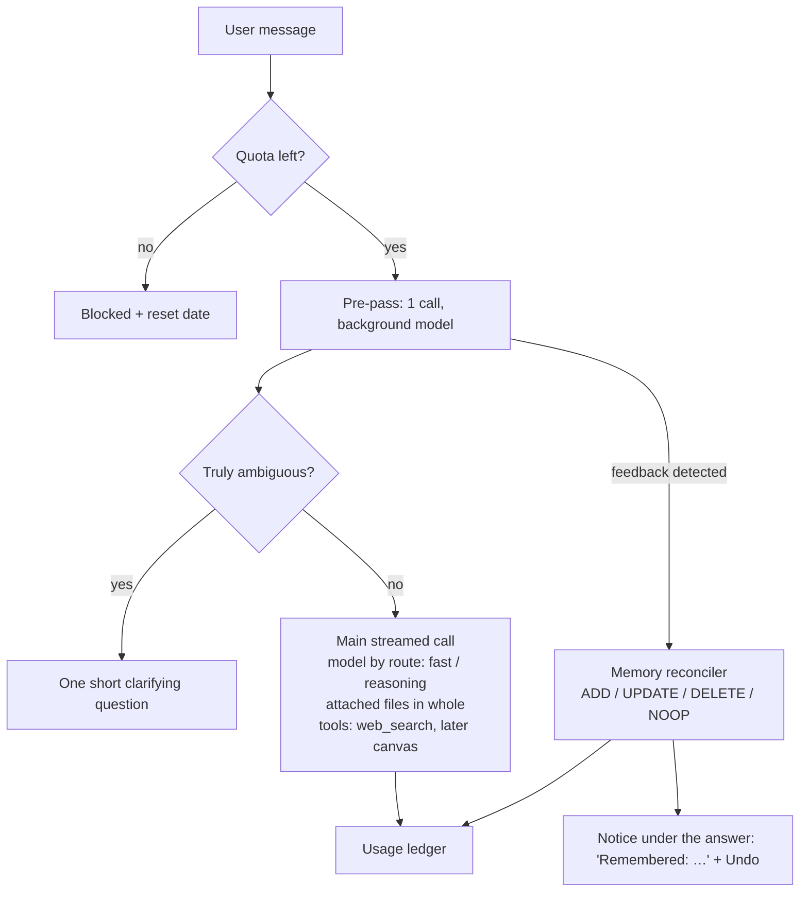

# Open Agent — Specification

A private AI chat app for friends and family (fewer than 50 people), as simple as DeepSeek's chat but with a memory
that learns how each person likes to work. Served at `open-agent.jonas.bzh`.

## Why

People in the circle use ChatGPT free and get poor results: a small model after a few messages, no lasting context,
short vague prompts. Open Agent fixes what a harness can fix:

- it learns each user's corrections and never makes the same mistake twice;
- it picks the right model for the task, without asking;
- it improves vague requests, or asks one short question when the request is truly ambiguous;
- it searches the web and reads documents and photos.

## Users and access

- Invitation only. The admin invites an email address; the invitation email holds a sign-in link valid 7 days.
- Sign-in: the person types their address and receives a **magic link and a 6-digit code**, both valid 15 minutes,
  once. The code exists for the installed app on iOS, which cannot receive the link (iOS opens it in Safari).
- The sign-in form answers the same for invited and unknown addresses, and sends nothing to the latter.
- Limits: 5 emails per address and 10 wrong codes per address every 15 minutes.
- Sessions last 180 days. Revoking a user ends all their sessions at once; inviting them again restores the access.
- Roles: `user`, `admin`. The `ADMIN_EMAIL` user is made admin at every boot. An admin cannot revoke themselves.
- Admin data access: conversations are stored in clear in the database. The admin commits not to read them; the admin
  panel shows costs and memory rules, never conversations.

## Cost model

- **Hybrid keys.** The app's OpenRouter key by default. An advanced user may add their own OpenRouter key (BYOK,
  OpenRouter only); their calls then use it and do not count against their quota.
- **Quota per user, per calendar month, in real cost.** Every paid call (answers, pre-pass, memory, titles) records the
  cost returned by OpenRouter; searches count at 0 $. The month starts at midnight on the 1st in Paris. Default quota
  5 $ (`DEFAULT_MONTHLY_QUOTA_USD`; the user expects 3 to 5 regular users), changed per person by the admin
  (0 to 100 $). Admins have no limit.
- **What users see:** a gauge in percent in the user menu ("This month: 65% used"), never dollars. From 80% a line
  above the composer says how much is used.
- **Over quota: blocked.** The check runs before each message (the message that crosses the limit is still answered).
  The server refuses with `quota_exceeded` (429), and the composer is replaced by "You have used all of your quota this
  month. It comes back on December 1." No silent downgrade.
- Total budget target: under 20 €/month. Background calls always use the cheapest configured model. Set a credit limit
  on the OpenRouter key itself as the global safety net.

## Per-message pipeline

### Pre-pass

One structured-output call on the background model (thinking off, about 0.6 s and 0.00006 $) returns:

- `route`: `fast` (thinking off) | `reasoning` (same model, thinking `medium`). No `vision` route: the same DeepSeek
  model reads pictures (measured on a screenshot: 1.1 s, 0.0002 $);
- `clarifyingQuestion`: one short question instead of an answer, or null. Never twice in a row: right after a
  question, the next turn always answers;
- `rewrittenRequest`: the same request, clear and in the first person, when it was written in a hurry, or null. Only
  the model sees it; the conversation keeps the user's words, and the answer's metadata keeps the rewrite;
- `feedback`: a lasting preference about how the assistant works ("your answers are always too long"), or null for a
  remark about the current task only ("shorter", about the letter being written);
- later `webSearch` (boolean).

The rules and examples sit in the instructions: OpenRouter does not show the schema's field descriptions to the model.
When the pre-pass fails, the user gets the `fast` answer to their own words. The user never picks a model; the answer
shows a "Deep thinking" line, pulsing while the model thinks, with its reasoning folded underneath.

### Memory: "never the same mistake twice"

- **Scope:** one global list of rules per user. Rules are about the work and how the user likes to use the tool, not
  about their identity. Every answer follows them: they close the system prompt.
- **Capture:** automatic. When the pre-pass returns `feedback`, the reconciler (background model) receives it with the
  current rules and returns one operation: `add`, `update` (replace or invert a rule), `delete`, or `none`. An edit
  naming a rule that is not the user's, or adding to a full memory, is dropped.
- **Contradiction:** a remark opposite to a stored rule updates that rule; it never adds a second, conflicting one.
- **Visible:** the change shows under the answer to the remark ("Updated: “Short answers.” → “Detailed answers.”"),
  with Undo and a link to the memory page. The notice is a `data-memory` part of the answer, so it stays in the
  conversation; after Undo it reads "Undone".
- **Undo:** puts the rule back as it was, once, and only while the rule is still as the change left it; otherwise
  "this preference changed since".
- **Control:** a "My memories" page (sidebar, for everyone) lists, adds, edits and forgets rules.
- **Limits:** 50 rules of 300 characters per user. Every change is kept in `memory_rule_changes`, which powers Undo.
- **The admin** reads a person's rules on the people page and forgets one the assistant misunderstood (recorded with
  the source `admin`).
- **Tu or vous:** French answers and clarifying questions say « vous » by default; « tu peux me tutoyer » becomes a
  rule, and rules win over the default. The interface always says « vous ».

## Features (all in V1)

### Chat

- Streaming answers (Vercel AI SDK UI message stream).
- Regenerate an answer; edit a sent message and resend (the later messages are replaced, no branches).
- Automatic conversation titles (background model); pin conversations.
- Full-text search in the history (SQLite FTS5).

### Web search

- **Services:** Tavily first (free plan: 1,000 searches a month, no card, refuses with `432` once used up), then our
  own SearXNG (free, titles and short extracts only). A used-up service is skipped until the 1st of next month; a
  service that fails for another reason is tried again at the next search. Both sit behind the `WebSearch` port.
  Compared on 2026-11-01: Parallel and Brave need a card, Exa's and Linkup's terms do not fit, Google and Bing closed.
- **When:** the main model has a `web_search` tool (query, `recent`) and uses it for facts that change or that it may
  not know. When the pre-pass sets `webSearch`, the first step must search. At most two searches, then the answer:
  the third step may not search.
- **What the user sees:** a line "Searching the web: “…”" pulsing in the answer, then one link per site read; the
  answer links its sources inline. A failed search says so and the model answers without it.
- **Language:** French users get French results (Tavily `language`, `country: france`; SearXNG `fr-FR`). Safe search on.
- **Cost:** each search is a `web_search` usage event at 0 $; each model step is its own `answer` event. Measured: a
  turn with two searches ≈ 0.0003 $.

### Files and photos

- **Rule: everything in a file reaches the model, at every answer.** A user who asks « vous avez vu … dans le
  fichier ? » must get a real answer, even ten messages later. Nothing is cut: a file the model cannot read whole
  (more than about 600,000 tokens) is refused at upload with a clear message, never read in part.
- **Adding:** the paperclip of the composer (from this device, take a photo on mobile, from my files), drag and drop,
  or paste a screenshot. At most 5 files per message, 20 MB each. Chips show them while they upload.
- **Photos:** made at most 2,048 px wide or tall in the browser (JPEG) before upload: fast on a phone, small print
  stays readable. The model sees them.
- **PDFs:** every page goes twice: its text (`pdftotext -layout`, keeps tables) and its picture (`pdftoppm`, 110 dpi).
  So charts, stamps, handwriting, pictures and scanned pages are read too. Measured: a page picture costs a few
  hundred tokens on DeepSeek.
- **Word (.docx):** mammoth's HTML (keeps tables), the pictures it contains, and the headers and footers mammoth
  skips, read from the zip with `unzip`. EMF/WMF drawings cannot be shown; the model is told one is there.
- **Text (.txt, .md, .csv):** as is. Not accepted: HEIC from browsers that cannot open it, .doc, Excel, PowerPoint,
  HTML, SVG.
- **Reading happens once, at upload**, into the file's `content`; the pictures are stored next to the original. Each
  answer turns the message's `file` parts into `<file name="…">` + text and pictures; the pre-analysis and the title
  only see the names (`[Attached: …]`), so the pre-analysis never asks what a file contains.
- **Personal library ("My files"):** every uploaded file stays, reusable in any conversation from the paperclip
  ("From my files", with a search). The page is a grid of tiles, not a list: an image fills its tile, a PDF shows
  its first page (`/api/files/:id/preview`), Word and text files show their icon and type. A tile opens the file;
  files are added with a button or dropped on the page, and deleted from the tile. A deleted file stays named in
  its conversations, and the model is told it is gone. No `@` mention, no RAG, no embeddings.
- **Privacy:** a file opens only for its owner (`/api/files/:id`, `nosniff`); a message may only point to the
  user's own library files, never to a link or inline data, so nothing skips the reading at upload.
- **Cost:** in the quota like the rest. Measured: 0.0001 to 0.0007 $ per answer with a 2-page PDF and a photo
  (about 3,200 tokens). A big file costs at every answer of its conversation.

### Canvas

A panel beside the conversation (full screen on a phone, `?doc=` in the address, back closes it) holding documents
written by the model and edited by the user, with versions.

- **The model's tools:** `create_document` (kind `document` or `html`, title, whole content) and `update_document`
  (id, whole new content). It writes any text to keep, send or print there, never in the chat, then answers in one
  or two sentences. A card in the answer ("Lettre de résiliation · Version 3") opens the document.
- **Live:** the panel opens as soon as the model starts writing and shows the text as it comes (read-only), then
  the saved document.
- **The model always works on the latest version:** the instructions hold the latest content of every document of
  the conversation, the user's own edits included; past versions in tool calls are left out of the history so a long
  document is not paid for again at every version.
- **Documents (Markdown):** edited like in Word with Tiptap (`@tiptap/markdown` reads and writes the Markdown the
  model uses), loaded only with the panel. Saved 1.2 s after typing stops. Saves within 10 minutes of the user's own
  last version change that version: one version per sitting. A save based on an older version is refused
  (`artifact_changed`): the panel then shows the model's newer version.
- **Versions:** a menu lists them (who, when); an old one shows read-only and can be brought back, as a new version.
- **Exports:** Word (`docx` in the browser, loaded on first use: headings, bold, italics, lists, links, tables, line
  breaks) and PDF through the browser's print dialog, from the page itself with a print stylesheet (printing an
  iframe fails in Safari on iPhone), always in light colors, with the title as the file name.
- **HTML pages:** a complete page with inline CSS and JavaScript (no React), shown in an `iframe` with `srcdoc` and
  `sandbox="allow-scripts allow-modals allow-forms"`, without `allow-same-origin`: the page can never reach the app,
  its API or its cookies (checked: reading `document.cookie` throws). Preview and Code tabs; downloadable `.html`.
- Other code (Python, etc.) stays in chat code blocks with highlighting and a copy button.

### Admin panel

- Invitations: create and revoke access by email. Cost per person for the month and their quota.
- **Models (Settings page):** the OpenRouter model of each role, changed at runtime, for the next message. The
  picker lists OpenRouter's models (kept an hour by the server, `:batch` variants left out), cheapest first, with
  their prices, and only those that can take the role: text and pictures in, tools, and thinking that can be turned
  off (OpenRouter's `reasoning.mandatory` unset) for `fast`; text and pictures in, tools and reasoning for
  `reasoning`; text in, structured JSON and thinking that can be turned off for `background`
  (`missingCapabilities`). The server checks it again on save. Thinking per role stays in the code (off, `medium`,
  off).
- **Prompts (Settings page):** the assistant, the analysis of each message and the memory prompts, edited whole, used
  from the next message, with "Bring back the original" (the text in `default-prompts.ts`). What depends on the
  conversation is always added by the code after the text: the date and the app's language, a missing web search,
  the canvas documents and the person's rules for the assistant; a question just asked for the analysis; a full
  memory for the memory. Structured outputs keep the JSON fields even if a prompt forgets them.
- **Memory:** a person's rules ("See their memory"), each one can be forgotten.

### Other

- UI in French and English (i18next) from the start; the model answers in the user's language.
- Responsive PWA, installable on the home screen.

## Out of V1

Voice, code execution, conversation branches, public share links, BYOK for providers other than OpenRouter, global
spending kill switch in the app.

## Stack

Same layout and tooling as `inscript-carte`.

| Layer | Choice |
| --- | --- |
| Monorepo | Turborepo, Bun workspaces (`apps/*`, `packages/*`) |
| Runtime | Bun |
| Server | `Bun.serve({ routes })`, hexagonal: `domain/`, `application/` (+ `ports/`), `infrastructure/`, `presentation/http/`, composition root in `app.ts` |
| Database | SQLite (`better-sqlite3`) + knex, migrations applied at boot, FTS5 for search |
| LLM | Vercel AI SDK with the OpenRouter provider |
| Client | Vite, React 19, TanStack Router, TanStack Query, i18next, Tailwind v4, shadcn (`radix-vega` style) |
| Shared | `packages/shared`: `API_ROUTES`, request and response types, `ApiError` codes |
| Email | Plunk API |
| Web search | Tavily, then self-hosted SearXNG |
| Lint, format | oxlint, oxfmt |
| Tests | `bun test`, co-located `*.test.ts` |
| Deploy | Two Docker images pushed to `registry.jonas.bzh` and recreated through the Portainer API: the app (API + built client on one port) and `open-agent-searxng` (SearXNG with `searxng/settings.yml` inside) |
| Development | `bun run dev` starts `compose.yaml` (SearXNG on `localhost:8888`), then the server and Vite |

## Look and feel

- Modeled on Chatbox AI: the sidebar and the top bar (page title) share one grey frame; the page is a white panel
  below the top bar, with a rounded top-left corner. A tinted "New conversation" button tops the sidebar, the user
  menu ends it. In dark mode the frame is darker than the panel.
- One brand color: indigo night `#2a2c6e` (`oklch(0.333 0.112 277)`), no gradients: actions, the icon, and the user's
  bubbles. Neutral greys elsewhere; the assistant's bubbles are grey.
- Dark mode: charcoal surfaces and a lighter indigo (`oklch(0.52 0.15 277)`), since `#2a2c6e` disappears on them.
  The user picks "Like the device", "Light" or "Dark" in the user menu; the choice is applied before the first paint.
- Rounded like Chatbox (`--radius: 0.625rem`): 8px on buttons, fields and menu items, 10px on lists, 14px on cards;
  round avatars and badges.
- Font: Figtree. Controls at least 40px high on sign-in and admin forms, for older users.
- Phones: the sidebar becomes a drawer. Chat: the user's messages in a bubble on the right, answers in a grey
  bubble with action badges ("Read contrat.pdf", "Web search"), documents as cards, memory changes as an inline
  notice with Undo, a bordered composer with attach and send buttons.

## Data model (first draft)

| Table | Holds |
| --- | --- |
| `users` | email, role, locale, invited at/by, last sign-in, revoked at, monthly quota in USD (`null`: the default); later: encrypted BYOK key |
| `sign_in_requests` | user, token hash, code hash (none for invitations), expiry, used at |
| `sessions` | token hash, user, expiry |
| `conversations` | id chosen by the client (UUID), user, title, pinned, created/updated at |
| `messages` | conversation, id (unique per conversation: the client chooses it), position, role, the whole AI SDK UI message as JSON; later an FTS5 index on its text |
| `memory_rules` | user, rule text, created/updated at, deleted at (kept so an Undo restores the same rule) |
| `memory_rule_changes` | user, rule, operation, before, after, source (`remark` / `user`), conversation and message of the notice, undone at |
| `library_files` | id (UUID, in its address), user, name, kind (`image` / `pdf` / `word` / `text`), media type, size, content (JSON: whole text and names of the pictures on disk), created at |
| `artifacts` | id (UUID, named by the model in `update_document`), conversation, user, kind (`document` / `html`), title, created/updated at |
| `artifact_versions` | artifact, number (from 1), content, author (`model` / `user`), created at |
| `usage_events` | user, conversation, purpose (`answer`, `pre_pass`, `memory`, `title`, `web_search`), model or search service, input/output/reasoning tokens, cost in USD from OpenRouter |
| `settings` | key (`model.fast`, `prompt.assistant`…), value, updated at; a missing key means the default |

## Configuration

| Env var | Purpose |
| --- | --- |
| `PORT` | HTTP port (default 3998) |
| `DATABASE_PATH` | SQLite file |
| `FILES_PATH` | Uploaded files and the pictures read out of them (default `data/files`; `/data/files` in the image) |
| `CLIENT_DIST_PATH` | Built client, served next to the API |
| `PUBLIC_URL` | Base URL in magic links |
| `ADMIN_EMAIL` | First admin |
| `DEFAULT_MONTHLY_QUOTA_USD` | Quota of users the admin did not set (default 5) |
| `OPENROUTER_API_KEY` | App key (required in production) |
| `FAST_MODEL` | Everyday answers until the admin page changes it; default `deepseek/deepseek-v4.1-flash-1017`, thinking off |
| `REASONING_MODEL` | Answers that need thinking, same; thinking `medium` |
| `BACKGROUND_MODEL` | Pre-pass, memory and titles, same; thinking off |
| `TAVILY_API_KEY` | First web search service (optional) |
| `SEARXNG_URL` | Our SearXNG, e.g. `http://open-agent-searxng:8080` (default `http://localhost:8888` in development) |
| `PLUNK_API_KEY` | Sign-in emails (unset in development: links and codes go to the server log) |
| `MAIL_FROM` | Sender address; its domain must be verified in Plunk |
| `ENCRYPTION_KEY` | Encrypts BYOK keys at rest |
